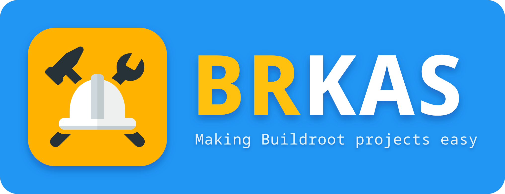

brkas does for [Buildroot](https://buildroot.org) what kas does for Yocto.

You describe your project in a YAML file:

- which Buildroot version to use;
- which br2-external trees to add;
- which defconfig to start from;
- which configuration changes to apply on top of it.

Then brkas downloads everything, configures Buildroot and builds the project with a
single command.

Here is a small project file:

```yaml
header:
  version: 1

buildroot:
  release: "2026.08.1"
  sha256: 38a6c152490096018720a9ade379ee1e571c9bf5f93a3657a166566945a98b0d

externals:
  yabi:
    url: https://github.com/angeloc/yabi.git
    refspec: main
    path: br-yabi

defconfig: arietta_xterm01_yabi

config:
  BR2_TARGET_GENERIC_HOSTNAME: demo
```

To build it:

```
brkas build project.yml
```

If you know kas, this table shows what each part of kas becomes in brkas:

| kas (Yocto)                      | brkas (Buildroot)                                   |
|----------------------------------|-----------------------------------------------------|
| `repos:`                         | `buildroot:` and `externals:`                       |
| `machine:`, `distro:`            | `defconfig:`                                        |
| `local_conf_header:`             | `fragments:` (files) and `config:` (single options) |
| `kas build`, `checkout`, `shell` | `brkas build`, `checkout`, `shell`                  |
| `kas dump --lock`, lock files    | `brkas dump --lock`, `brkas lock`, `*.lock.yml`     |
| `kas-container`                  | `brkas-container`                                   |
| `kas menu`                       | `brkas menuconfig`, `xconfig`                       |

## Installation

Install brkas from [PyPI](https://pypi.org/project/brkas/):

```
pipx install brkas
```

This installs two commands, `brkas` and `brkas-container`.

To also check your project files against the schema of brkas, install it with the `schema`
extra:

```
pipx install 'brkas[schema]'
```

To install from a checkout of this repository instead, run `pipx install .` in it.

brkas needs Python 3.10 or newer and PyYAML. To build directly on your machine, you also
need the tools Buildroot itself needs (make, gcc, git and so on). If you use
`brkas-container` instead, you only need Python and Docker or Podman.

## Quick start

The examples are in this repository. From a checkout of it:

```
brkas build examples/x86_64.yml
```

This command:

1. downloads Buildroot 2026.08.1 and checks its SHA-256;
2. configures a small x86_64 system (`examples/configs/x86_64_defconfig`) that uses the
   Bootlin prebuilt toolchain, adds SSH (`examples/fragments/ssh.config`) and sets a host
   name;
3. builds the result in `build/x86_64`. There is no compiler and no kernel to build, so
   it only takes a few minutes.

The `examples` directory has more projects:

| File                        | What it shows                                                  |
|-----------------------------|----------------------------------------------------------------|
| `x86_64.yml`                | a Buildroot release tarball and a defconfig file of your own   |
| `aarch64.yml`               | a generic ARM system, with Buildroot cloned from git at a tag  |
| `arietta-xterm01-yabi.yml`  | a br2-external tree taken from another git repository          |

## The project file

You can split a project into several files. `brkas build a.yml:b.yml` reads `a.yml` first,
then `b.yml`. Values in `b.yml` replace the ones in `a.yml`.

Here is every section, with comments:

```yaml
header:
  version: 1                 # required, always 1 for now
  includes:                  # other files to read first; this file wins over them
    - common.yml             # a path, relative to this file
    - repo: yabi             # or a file inside a repository
      file: br-yabi/brkas/base.yml

buildroot:                   # where Buildroot comes from, pick one way:
  url: https://gitlab.com/buildroot.org/buildroot.git
  refspec: 2026.08.1         #   a git repository, at a branch, tag or commit;
  # release: "2026.08.1"     #   an official release tarball;
  # tarball: <url or file>   #   any other tarball;
  # sha256: <hash>           #   (the expected SHA-256 of the tarball)
  # dir: ../buildroot        #   a directory you already have, used as it is
  patches:                   # patches applied after the download
    fix: patches/buildroot   #   a patch file, or a directory of *.patch files
    other:                   #   or patches from a repository
      repo: yabi
      path: patches/buildroot

externals:                   # br2-external trees, same choices as buildroot:
  yabi:
    url: https://github.com/angeloc/yabi.git
    refspec: main
    path: br-yabi            # where the external is inside the repository
  local:
    dir: ../my-external

defconfig: arietta_xterm01_yabi  # a defconfig name from Buildroot or an external,
                                 # or a file path (with a /), or {repo:, file:}

fragments:                   # configuration fragments added to the defconfig, in order
  debug: fragments/debug.config
  board:
    repo: yabi
    file: br-yabi/fragments/x.config

config:                      # single options, applied last
  BR2_TARGET_GENERIC_HOSTNAME: demo   # strings get quotes automatically
  BR2_PACKAGE_DROPBEAR: y             # y, n or m
  BR2_TARGET_ROOTFS_EXT2_SIZE: "128M"

build:
  dir: build                 # where outputs go (default: build/)
  name: demo                 # the output directory name (default: the file name)
  targets: [all]             # what "brkas build" makes by default
  dl_dir: ~/.cache/brkas/dl  # download cache, shared between projects

env:                         # environment variables for make
  MAKEFLAGS: -j12            # with BR2_PER_PACKAGE_DIRECTORIES: y, builds
                             # several packages at the same time

container:                   # default settings for brkas-container
  image: brkas:0.1.2
  engine: podman
  options: [--network=host]
```

Some rules to know:

- When two files set the same section, their contents are merged. Inside a section, a
  later value replaces an earlier one.
- Setting a key to `null` removes it. For example, `fragments: {debug: null}` removes a
  fragment that an included file added.
- A path is relative to the file where it is written.
- Quote values that look like numbers, such as `release: "2026.08"`. Otherwise YAML reads
  them as numbers and brkas rejects them.

After configuring, brkas checks the result. If an option you asked for is not in the final
configuration, brkas prints a warning. This usually means the option depends on another
option that is not enabled.

## Commands

```
brkas init [dir]                    # create a demo project to start from
brkas checkout project.yml          # download everything and configure
brkas build project.yml [targets]   # the same, then build
brkas shell project.yml [-c cmd]    # open a shell to build other software for the target
brkas menuconfig project.yml --save fragments/mine.config   # or xconfig
brkas dump project.yml [--lock]     # print the merged project
brkas lock project.yml              # write project.lock.yml
brkas for-all-repos project.yml 'git log -1 --oneline'
brkas clean project.yml [--all]     # remove the output (--all: the repositories too)
brkas clean --all                   # remove everything brkas made in the work directory
brkas clean --cache project.yml     # remove only the download cache (build.dl_dir)
```

brkas puts the downloaded repositories in the work directory: `buildroot/`, plus one
directory for each external. Builds go in `build/`. The work directory is the current
directory, unless you set `--work-dir` or `$BRKAS_WORK_DIR`.

When the work directory is inside a git repository, such as your project, brkas keeps what it
creates out of git: it adds each directory it creates (`buildroot/`, the externals, `build/`,
`downloads/`) to `.git/info/exclude` of that repository. This file belongs to your clone only
and is never committed, so `git status` and `git add -A` don't see these directories.

Two options control the repositories:

- `--update` fetches new commits, so that a branch moves forward.
- `--force` throws away your local changes in the repositories. Without it, brkas stops
  instead of touching them.

`brkas clean --all` deletes the repositories that brkas cloned. Before deleting anything, it
checks each one for work that is saved nowhere else: changed or new files, and commits that
are on no remote. If it finds some, it lists them and deletes nothing. Commit and push that
work first, or add `--force` to delete it anyway.

### brkas init

`brkas init myproject` creates the directory `myproject` with a project to start from:

- `demo.yml`, a project file with comments, that builds a small x86_64 system;
- `README.md`, a few lines on how to build it;
- `.gitignore`, which keeps out of git the directories that brkas creates, for everyone who
  clones the project.

It also creates a git repository there, with `main` as its branch, unless the directory is
already in a git repository.
Without a directory, it uses the current one. It never overwrites a file.

```
brkas init myproject
cd myproject
brkas build demo.yml
```

### brkas shell

`brkas shell` opens a bash shell in the output directory, ready to cross-compile other
software for your target. It loads Buildroot's SDK environment (`host/environment-setup`):

- the cross compiler is in `PATH`;
- `CC`, `CFLAGS`, `ARCH`, `CROSS_COMPILE` and `KERNELDIR` are set;
- the `configure` and `cmake` aliases use the right options.

`make` still works in this shell.

The first time, brkas enables the Buildroot option that creates this environment
(`BR2_PACKAGE_HOST_ENVIRONMENT_SETUP`). If the SDK is not built yet, brkas runs
`make sdk` before opening the shell. It does the same when the project configuration
changed since the last SDK, so that the SDK always matches the project. While it builds, brkas shows a spinner and writes
the build output to `brkas-sdk.log` in the output directory. The option stays enabled
after that. You can still turn it off in `config:`.

Here is the first `brkas shell` of the x86_64 example, run in the container:

```
$ brkas-container shell examples/x86_64.yml
brkas: buildroot: downloading https://buildroot.org/downloads/buildroot-2026.08.1.tar.gz
brkas: buildroot: unpacking buildroot-2026.08.1.tar.gz
brkas: configuring /home/user/work/build/x86_64 from x86_64_defconfig
brkas: building the SDK: make sdk, output in /home/user/work/build/x86_64/brkas-sdk.log
brkas: building the SDK: done in 01:20
brkas: shell in /home/user/work/build/x86_64: exit to leave
 _           _ _     _                 _
| |__  _   _(_) | __| |_ __ ___   ___ | |_
| '_ \| | | | | |/ _` | '__/ _ \ / _ \| __|
| |_) | |_| | | | (_| | | | (_) | (_) | |_
|_.__/ \__,_|_|_|\__,_|_|  \___/ \___/ \__|

       Making embedded Linux easy!

Some tips:
* PATH now contains the SDK utilities
* Standard autotools variables (CC, LD, CFLAGS) are exported
* Kernel compilation variables (ARCH, CROSS_COMPILE, KERNELDIR) are exported
* To configure do "./configure $CONFIGURE_FLAGS" or use
  the "configure" alias
* To build CMake-based projects, use the "cmake" alias

(brkas) user@cd1fc8f3192e:/home/user/work/build/x86_64$
```

### brkas menuconfig and xconfig

These commands open Buildroot's configuration tools: `brkas menuconfig`, or `brkas xconfig`
for the graphical one. xconfig needs Qt 5, and it is not available in `brkas-container`.

When you close the tool, brkas finds what you changed. With `--save FILE`, it writes only
those changes to a fragment file, which you can then add to `fragments:`.

### Lock files

`brkas lock project.yml` writes `project.lock.yml`. This file records the exact commit
of every git repository and the SHA-256 of every tarball.

When a lock file sits next to a project file, brkas reads it automatically. If you commit
the lock file, everyone builds from exactly the same sources.

To move to newer sources, run `brkas lock --update project.yml`, or delete the lock file.

## Building in a container

```
brkas-container build project.yml   # run any brkas command inside it
```

The first time, brkas-container builds its image (`brkas:<version>`) from the Dockerfile it
ships with, which takes a few minutes. Later runs reuse it. `brkas-container --build-image`
builds it again, for example after updating brkas.

The image is a plain Debian with the packages that the Buildroot manual asks for, cmake,
and brkas. With cmake in the image, Buildroot does not need to compile its own, and the
`cmake` alias of `brkas shell` works. When the project builds cmake in the SDK
(`BR2_PACKAGE_HOST_CMAKE`), the shell uses that one instead. Nothing in it comes from Buildroot, so it can build any Buildroot version.

- The work directory, the project files and the download cache appear inside the
  container at the same paths as on your machine.
- The container runs as your user, so the files it creates belong to you.
- Your home directory has the same path inside the container, so `~` means the same
  thing. It starts empty: only the directories above are shared from it.

Other directories are not visible inside the container. To work on your own software from
`brkas-container shell`, share its directory with `--mount DIR` (you can repeat it):

```
brkas-container --mount ~/src/myapp shell project.yml
```

The directory appears at the same path inside the container, and you can read and write
it. So in the shell you can `cd ~/src/myapp` and build it with the cross compiler. The
option exists only on the command line, so that your local paths stay out of the project
files.

Nothing of your SSH setup is passed to the container by default. For private
repositories, there are two options, as in kas-container:

- `--ssh-agent` forwards your running SSH agent to the container;
- `--ssh-dir DIR` (or `$BRKAS_SSH_DIR`) shares a directory with SSH keys and configuration.
  The directory is mounted read-only and copied to `~/.ssh` inside the container.

With `--ssh-dir`, the container can read every key in that directory. So it is better to
use a directory with only the keys the project needs, not your whole `~/.ssh`.

## Tests

```
python3 -m pytest tests
```

The integration tests need a Buildroot git tree. They use `$BRKAS_TEST_BUILDROOT`, or
`~/buildroot` by default.

## License

GPL-2.0-or-later. See COPYING.
